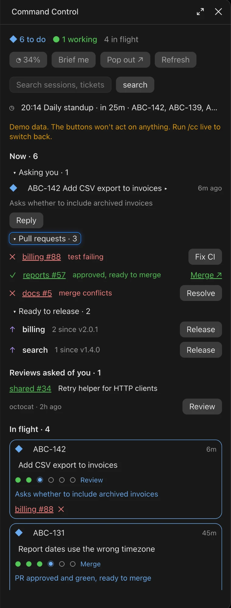
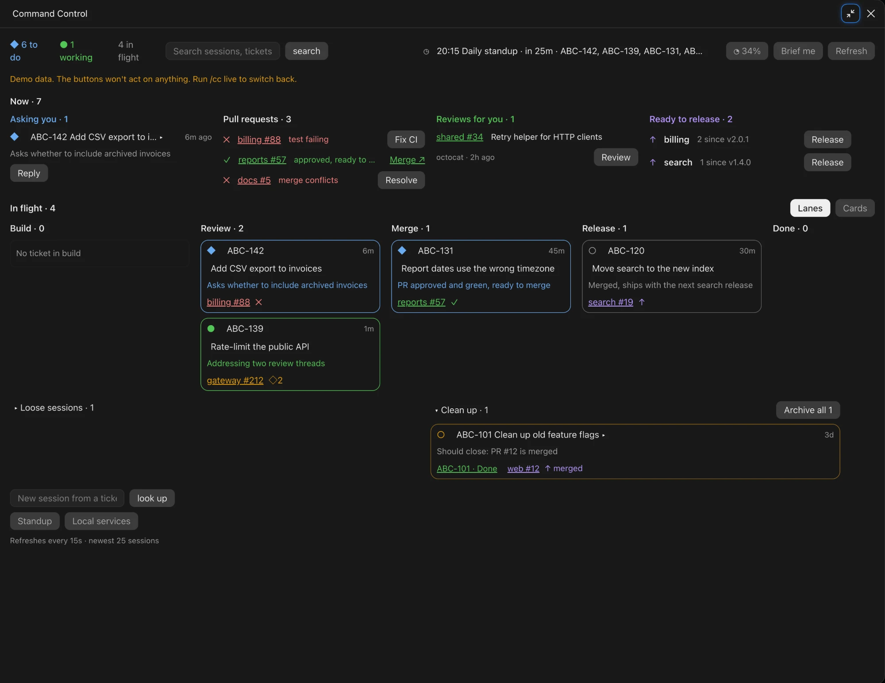
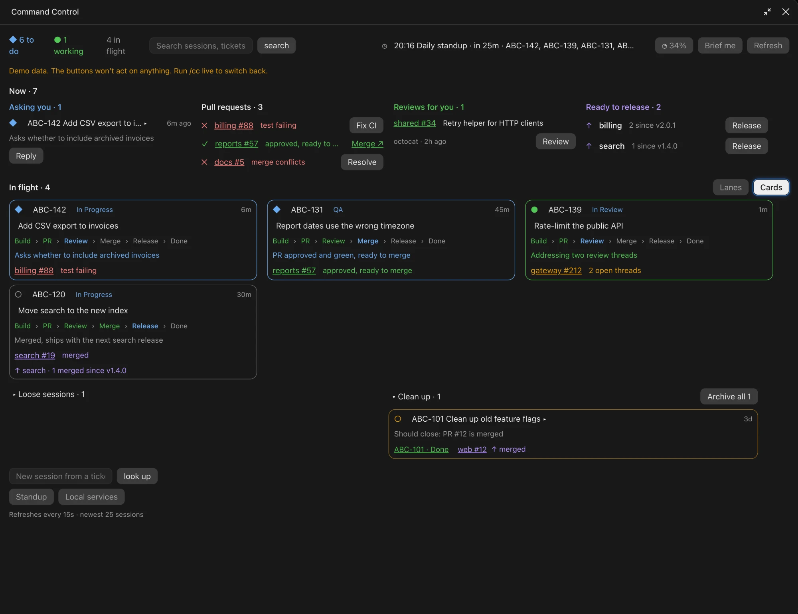

# Command Control for Claude Code

When you run many Claude Code sessions at once, it gets hard to see which one is waiting on you, which pull request needs a fix, and what is ready to ship. Command Control is a pane in the Claude desktop app that puts all of it on one board: your sessions, the tickets and pull requests they belong to, what needs you right now, and what is waiting to be released.



## What it does

- **Now.** Everything waiting on you, each with one button:
  - sessions asking you something (**Reply**, **Open**)
  - pull requests with failing checks, merge conflicts or open review threads (**Fix CI**, **Resolve**, **Address**), sent to the conversation that owns the pull request
  - pull requests that are approved and green (**Merge ↗**)
  - pull requests where your review was requested (**Review**); `/cc-setup` can limit these to requests made to you directly, and to pull requests updated in the last few days
  - services with merged work that hasn't been released (**Release**)
- **In flight.** Your work grouped by ticket, with its stage: Build › PR › Review › Merge › Release › Done. Open a ticket to see its sessions, pull requests and release, and to mark it done.
- **Since you looked.** What changed while you were away: checks that failed or passed, approvals, merges, new review threads, sessions that finished. **Brief me** sums it up in five bullets with links.
- **Search.** One box for session transcripts, tickets, pull requests and your docs search. **Ask Claude about this** starts a session with the results.
- **Your day.** The next meeting with a join link and the tickets it covers, plus a standup draft from the last 24 hours.
- **Housekeeping.** Sessions that look finished are suggested for clean up, with **Archive all**.
- **Everywhere.** A one-line "◆ 2 need you" band above the prompt in every session, and a notification when a session finishes.

Expand the pane (⤢) and the board spreads out. **Now** becomes four columns, and **In flight** shows your tickets as lanes by stage, or as cards.





## What you need

- The **Claude desktop app**, in the Code tab. Command Control lists and acts on sessions through the app's own session tools, so it doesn't work in a plain terminal.
- Optional sources, each one turning on a part of the board:
  - **GitHub** through the `gh` CLI, signed in: pull requests, review requests and releases, from every repository or only the owner's you choose
  - **Jira** through an Atlassian connector, or **Linear** through a Linear connector: ticket names, statuses and stages
  - **A Glean-style docs search** connector: docs in search
  - **Google Calendar** connector: the next meeting

Without a source, its part of the board stays off. Sessions, the band and transcript search always work.

## Install

In the Claude desktop app: click **+** next to the prompt box, then **Plugins**, **Add marketplace**, enter `offerni/claude-command-control`, then **Add plugin**.

Or, from a terminal session of Claude Code:

```
/plugin install session-board --marketplace offerni/claude-command-control
```

Answer `y` to add the marketplace and pick the user scope.

## Set up

Run `/cc-setup` in any session. Claude checks which of the sources above you have, asks which ones to use, tries each with one real call, and saves your choices once you confirm them. Run it again any time to change them.

### Starter skills

Two board buttons start a session with a command of yours: **Start with …** on a ticket and **Release** on a repository with unreleased work. If you already have a skill, command or prompt for either, whatever its name, `/cc-setup` asks for it and the button runs it. If you don't, `/cc-setup` can write one for you, under a name you choose (`start-ticket` and `cut-release` by default):

- `/start-ticket <key>` takes a ticket to a pull request with passing checks: read the ticket and the code, plan, branch, build test-first, run tests and lint, review the diff, open the pull request, watch the checks.
- `/cut-release <repo>` lists what merged since the last release, suggests the version, drafts the notes, publishes once you confirm, and follows the release workflow.

Setup looks at one of your repositories first (default branch, tags, test and lint commands, branch and commit style), then asks about your workflow with those as suggestions, and writes the skills to `~/.claude/skills/` (or one repository's `.claude/skills/`) with your answers in them. They are plain skill files: edit them any time. Without a command, the buttons fall back to a built-in prompt that reads the ticket and proposes an approach, or follows the repository's own release process and checks with you before publishing.

Then run `/cc` to open the board.

To look around before connecting anything, run `/cc demo`. It fills the board with made-up sample work and fetches nothing. `/cc live` switches back.

## Commands

| Command | What it does |
|---|---|
| `/cc` | Opens Command Control |
| `/cc demo` / `/cc live` | Switches between sample data and your real data |
| `/cc-setup` | Picks and tests your sources, writes starter skills if you want them, then saves your choices |
| `/start-ticket`, `/cut-release` | The starter skills under their default names, once `/cc-setup` has written them |
| `/board`, `/board2` | Two older, simpler layouts of the same data |

## How it works

- One open Command Control does the fetching every 15 seconds: the session list from the Claude app, pull requests and releases from `gh`, tickets, the calendar. It writes everything to the plugin's shared store. Any other Command Control, in another session or window, only reads that store. If the fetching session closes, another one takes over within about 45 seconds.
- **Pop out ↗** opens the board in a dedicated "Command Control" session with its own window. The app draws one pane once and shows that same drawing everywhere it appears, so a separate session is what keeps the pop-out from changing your side panel.
- The one-line state on each session is written by Claude Haiku from the session's last reply. It runs once per new reply, only in the fetching session. **Brief me** and reply suggestions call Haiku only when you press them.

## Privacy

Everything stays on your machine and your own accounts. Command Control reads your sessions through the Claude app, calls only the connectors and `gh` you chose in `/cc-setup`, and sends messages to a session only when you press a button. Messages it sends say they came from the board, and text it passes along from pull requests, tickets or search results is marked as data, not instructions. Settings change only after you confirm them in a dialog.

## Development

The plugin is a hooks module (`hooks/register.tsx`) with its tests next to it. Claude Code writes the plugin API types to `.claude-plugin/types/` when it loads the plugin, and `tsconfig.json` reads them from there.

```
claude plugin validate session-board
claude plugin test session-board
```

## License

MIT
